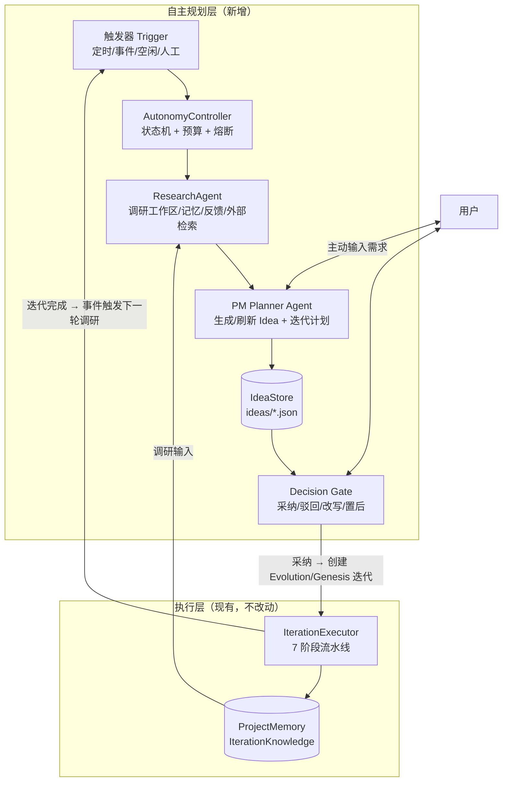
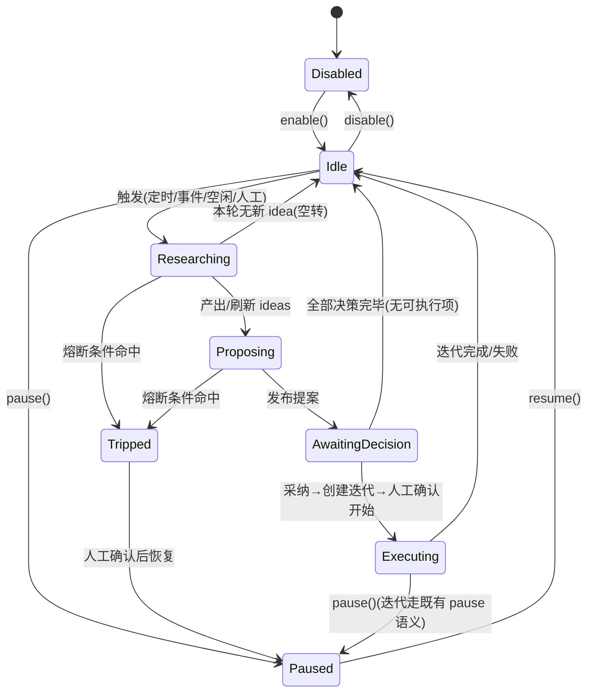

# Cowork Forge 自主模式（Autonomous Mode）架构设计方案

> 状态：**已实现**（2026-10-31，Phase 0–3 落地；实现规格见 `spec.md`，任务状态见 `tasks.md`）｜ 依据：2026-10-31 源码实读（commit fbaab05）｜ 范围：本文件是方案来源，实现细节以 `spec.md` 为准

---

## 0. 结论与核心架构判断

**一句话方案**：在现有 7 阶段流水线**上方**新增一个「PM 自主规划环（Planner Loop）」，由 PM Agent 周期性调研项目并产出结构化的 **Idea 提案**，人只在**决策门（Decision Gate）**做采纳/驳回/改写/置后；被采纳的 Idea 复用现有 `Iteration::create_evolution/create_genesis` + `IterationExecutor` 进入既有流水线执行。**不改动 7 阶段本身**。

核心判断（每条在后文有源码依据）：

1. **调研/规划环与执行流水线分层，不要做成第 8 个 stage。** `Iteration` 的 [`Artifacts`](file:///d:/workspace/SAW_S/cowork-forge/crates/cowork-core/src/domain/iteration.rs#L232-L241) 是按阶段硬编码的六个字段，`complete_stage` 也是硬编码 match（[iteration.rs#L155-L170](file:///d:/workspace/SAW_S/cowork-forge/crates/cowork-core/src/domain/iteration.rs#L155-L170)）；把"调研"塞进流水线会侵入迭代生命周期并污染工件语义。自主规划是"产生迭代"的活动，天然是流水线的**上游**。
2. **PM 角色已存在但只是"售后应答器"，需升级为"提案者 + 规划者"。** `create_project_manager_agent()`（[agents/mod.rs#L98-L119](file:///d:/workspace/SAW_S/cowork-forge/crates/cowork-core/src/agents/mod.rs#L98-L119)）目前只在用户发消息时被动响应（意图识别 → `pm_goto_stage` / `pm_create_iteration`）。自主模式是把它从"一问一答"扩展为"主动提案"，而非新建一个平行角色。**本方案仅面向 GUI**（CLI 不在范围内，见 §2），PM 仅 GUI 接入不再是问题。
3. **Idea 必须是新的领域实体，不能复用 `Feedback` 或 `Iteration.draft`。** 现有 [`Feedback`](file:///d:/workspace/SAW_S/cowork-forge/crates/cowork-core/src/data/models.rs#L290-L304) 是"对某阶段的修订意见"，生命周期即被消费（`clear_stage_feedback`）；Idea 有"提议→决策→转迭代"的长生命周期和可追溯决策记录，语义不同（详见 §1.4、§9）。
4. **触发机制现状为零，必须新建 `AutonomyController`。** 全仓没有 cron/interval/调度器（仅有 `tokio::time::sleep` 用于限流退避、GUI 进程轮询与 HITL 超时）。同时存在 `CURRENT_ITERATION_ID`、`GOTO_STAGE_SIGNAL`、`set_execution_llm` 等**全局单例状态**（见 §1.6），隐含"同一时刻只有一个迭代在执行"的假设——自主循环发起的执行必须与人工触发的执行**互斥**，这是硬约束。
5. **成本边界直接由限流器决定：全局 30 req/min + 突发 5**（[`rate_limiter.rs#L14-L15`](file:///d:/workspace/SAW_S/cowork-forge/crates/cowork-core/src/llm/rate_limiter.rs#L14-L15)），不可绕过。自主循环每轮都是一次或多次 LLM 调用，必须叠加**预算记账（BudgetGuard）与熔断**，否则会和用户正在执行的迭代抢配额。
6. **有 3 个阻塞问题需前置解决**：① Idea 生命周期无处表达（需新增 `Idea` 聚合与 `IdeaStore`）；② 无任何调度/后台循环原语（自主循环宿主 = GUI 进程内 tokio task，需新建 `AutonomyController` + 执行互斥）；③ PM 提示词与注册工具名不一致（`respond_to_user` vs `pm_respond`，见 §1.3）。原先列为阻塞项的"PM 仅 GUI 接入 / 双端一致性"随 CLI 出范围而消解。

---

## 1. 现状事实（源码调研结果）

### 1.1 Pipeline：7 阶段、StageExecutor、goto_stage 与 flow 配置

**7 个阶段**：`idea → prd → design → plan → coding → check → delivery`。

| 事实 | 位置 |
|------|------|
| `Stage` trait：`name/description/needs_confirmation/execute/execute_with_feedback` | [pipeline/mod.rs#L64-L93](file:///d:/workspace/SAW_S/cowork-forge/crates/cowork-core/src/pipeline/mod.rs#L64-L93) |
| `StageResult`：`Success / Failed / Paused / NeedsRevision / GotoStage(String, String)` | [pipeline/mod.rs#L37-L44](file:///d:/workspace/SAW_S/cowork-forge/crates/cowork-core/src/pipeline/mod.rs#L37-L44) |
| `create_stage_by_id()` 由 stage id 创建阶段（硬编码 match，未知 id 返回 None 并 warn） | [pipeline/mod.rs#L117-L131](file:///d:/workspace/SAW_S/cowork-forge/crates/cowork-core/src/pipeline/mod.rs#L117-L131) |
| `get_stages_from_flow()`：从 `global_registry().get_default_flow()` 读 `stage_id` 列表、按 `start_stage` 截断、逐个 `create_stage_by_id()` | [pipeline/mod.rs#L135-L162](file:///d:/workspace/SAW_S/cowork-forge/crates/cowork-core/src/pipeline/mod.rs#L135-L162) |
| 默认 flow：`config_definition/default_configs/flows/default.json`，每项仅 `stage_id` | 同目录 |
| `FlowDefinition / StageReference / FlowConfig`（`stop_on_failure`、`max_total_time_secs`、`save_state_on_interrupt`、`memory_scope`、`inheritance.stage_mapping`） | [flow_definition.rs#L107-L192](file:///d:/workspace/SAW_S/cowork-forge/crates/cowork-core/src/config_definition/flow_definition.rs#L107-L192) |
| `StageDefinition`：`stage_type(Simple/ActorCritic)`、`agent`、`actor_critic{actor, critic, max_iterations}`、`needs_confirmation`、`artifacts`、`hooks`、`timeout_secs`、`retry` | [stage_definition.rs#L71-L145](file:///d:/workspace/SAW_S/cowork-forge/crates/cowork-core/src/config_definition/stage_definition.rs#L71-L145) |

**执行驱动**（[pipeline/executor/mod.rs](file:///d:/workspace/SAW_S/cowork-forge/crates/cowork-core/src/pipeline/executor/mod.rs)）：

- 入口 `IterationExecutor::execute(project, iteration_id, resume_stage, model: Option<Arc<dyn adk_core::Llm>>)`（L81-L103）；`model` 为 None 时由 `load_config()+create_llm_client()` 创建一次并 `set_execution_llm()`（全局单例）。
- `execute_inner`（L105-L176）：准备 workspace → `start_stage = resume_stage || iteration.current_stage || iteration.determine_start_stage()` → `get_stages_from_flow()` → `iteration.start()` → `MemoryStore::ensure_iteration_memory` → 演进迭代注入 `inject_project_knowledge` → `execute_stages_from`。
- `execute_stages_from`（L183 起）防失控常量：`MAX_STAGE_RETRIES=3`、`RETRY_DELAY_MS=5000`、`MAX_FEEDBACK_LOOPS=5`、`MAX_GOTO_DEPTH=10`（goto 用 `Box::pin` 递归 + 深度上限，见 L294-L327）。
- 关键阶段（`is_critical_stage` = idea/prd/design/plan/coding，[mod.rs#L176-L178](file:///d:/workspace/SAW_S/cowork-forge/crates/cowork-core/src/pipeline/mod.rs#L176-L178)）完成后 `iteration.pause()` 并走 HITL：`request_confirmation_with_feedback` → [`ConfirmationAction::{Continue, ViewArtifact, ProvideFeedback(String), Cancel}`](file:///d:/workspace/SAW_S/cowork-forge/crates/cowork-core/src/pipeline/executor/interaction_ext.rs#L7-L11)（L378-L449）。
- 迭代完成：`iteration.complete()` + `MemoryStore::promote_insights_to_decisions`（L521-L528）。
- 另有 `continue_iteration`（仅 Paused）、`retry_iteration`（仅 Failed，接收 model 参数）。

**goto_stage 的"类型安全控制流"**（对应 project memory 教训）：

- 工具侧（[goto_stage_tool.rs](file:///d:/workspace/SAW_S/cowork-forge/crates/cowork-core/src/tools/goto_stage_tool.rs)）：写 `Feedback` 到 `session/feedback.json` + 更新 `SessionMeta.current_stage` + `set_goto_stage_signal()`（全局 `Mutex<Option<(String,String)>>`，[pipeline/mod.rs#L18-L34](file:///d:/workspace/SAW_S/cowork-forge/crates/cowork-core/src/pipeline/mod.rs#L18-L34)）+ `EventActions.escalate=true` 与 `state_delta`（L86-L92）。
- 执行侧：`stage_executor.rs` 在事件流中检测信号并返回 `StageResult::GotoStage`，executor 匹配该**枚举**（而非解析错误字符串）重启 flow（executor/mod.rs#L278-L328）。
- 注意：这是**进程内全局信号**，同样隐含单迭代并发假设。

### 1.2 Domain：Project / Iteration / Memory

| 聚合 | 字段（逐字） | 位置 |
|------|------------|------|
| `Project` | `id, name, created_at, updated_at, metadata: ProjectMetadata{tech_stack, project_type, language}, current_iteration_id: Option<String>, iterations: Vec<IterationSummary>` | [project.rs#L4-L14](file:///d:/workspace/SAW_S/cowork-forge/crates/cowork-core/src/domain/project.rs#L4-L14) |
| `Iteration` | `id, number, title, description, base_iteration_id: Option<String>, inheritance: InheritanceMode, status, started_at, completed_at, current_stage: Option<String>, completed_stages: Vec<String>, artifacts: Artifacts` | [iteration.rs#L6-L27](file:///d:/workspace/SAW_S/cowork-forge/crates/cowork-core/src/domain/iteration.rs#L6-L27) |
| `IterationStatus` | `Draft, Running, Paused, Completed, Failed` | [project.rs#L71-L79](file:///d:/workspace/SAW_S/cowork-forge/crates/cowork-core/src/domain/project.rs#L71-L79) |
| `InheritanceMode`（domain） | `None（创世）、Full（复制全部代码+工件）、Partial（只复制代码、重新生成文档）`，**Default = Full** | [iteration.rs#L217-L230](file:///d:/workspace/SAW_S/cowork-forge/crates/cowork-core/src/domain/iteration.rs#L217-L230) |
| `Artifacts` | `idea/prd/design/plan/coding/delivery: Option<String>`（路径） | [iteration.rs#L232-L241](file:///d:/workspace/SAW_S/cowork-forge/crates/cowork-core/src/domain/iteration.rs#L232-L241) |
| `ProjectMemory` | `decisions: Vec<Decision>, patterns: Vec<Pattern>, context, iteration_knowledge: HashMap<String, IterationKnowledge>` | [memory.rs#L5-L13](file:///d:/workspace/SAW_S/cowork-forge/crates/cowork-core/src/domain/memory.rs#L5-L13) |
| `IterationKnowledge` | `iteration_id, iteration_number, idea/prd/design/plan_summary, tech_stack, key_decisions, key_patterns, code_structure, known_issues, created_at` | [memory.rs#L82-L113](file:///d:/workspace/SAW_S/cowork-forge/crates/cowork-core/src/domain/memory.rs#L82-L113) |

生命周期：`create_genesis/create_evolution` 初始 `Draft` → `start()→Running` → 关键阶段后 `pause()→Paused` → HITL `resume()` → `complete()→Completed`（`finalize_completed_stages` 兜底）；失败 `fail()→Failed`（保留 `current_stage` 供 retry）。演进继承的起点由 `determine_start_stage()` 经 flow 的 `inheritance.stage_mapping` 决定（[iteration.rs#L174-L203](file:///d:/workspace/SAW_S/cowork-forge/crates/cowork-core/src/domain/iteration.rs#L174-L203)）。

**易错点**：存在**两个同名 `InheritanceMode`**——`domain::InheritanceMode`（默认 `Full`）与 `config_definition::flow_definition::InheritanceMode`（[flow_definition.rs#L181-L192](file:///d:/workspace/SAW_S/cowork-forge/crates/cowork-core/src/config_definition/flow_definition.rs#L181-L192)，默认 `Partial`）。语义注释一致但**默认值不同**，自主模式创建迭代时必须显式指定，禁止依赖 Default。

### 1.3 PM 角色现状：有什么、缺什么

**已有**（数据驱动 + 运行时双份定义）：

- 配置：[`pm_agent.json`](file:///d:/workspace/SAW_S/cowork-forge/crates/cowork-core/src/config_definition/default_configs/agents/built-in/pm_agent.json)（`id: "pm_agent"`, `agent_type: "simple"`, `instruction: "builtin://project_manager"`, tools: `pm_goto_stage/pm_create_iteration/pm_respond/pm_save_decision/read_file/list_files/read_file_truncated/query_memory`）。
- 运行时构造：`create_project_manager_agent()`（[agents/mod.rs#L98-L119](file:///d:/workspace/SAW_S/cowork-forge/crates/cowork-core/src/agents/mod.rs#L98-L119)），另挂 MCP toolsets（`add_mcp_toolsets_to_builder`，即 Tavily/DeepWiki 若配置则可用）。
- 提示词：[`PROJECT_MANAGER_AGENT_INSTRUCTION`](file:///d:/workspace/SAW_S/cowork-forge/crates/cowork-core/src/instructions/project_manager.rs#L3-L158)——**售后场景**：意图分类（bug_fix/requirement_change/new_feature/consultation/ambiguous）→ 四操作（goto_stage/create_iteration/answer_question/ask_clarification）。
- 工具：[`pm_tools.rs`](file:///d:/workspace/SAW_S/cowork-forge/crates/cowork-core/src/tools/pm_tools.rs)——`PMGotoStageTool`（写 Feedback + SessionMeta，**不**设置 goto 信号，实际重启由 GUI 按钮转译）、`PMCreateIterationTool`（直接 `Iteration::create_evolution` + 落盘）、`PMRespondTool`、`PMSaveDecisionTool`。
- 执行入口：`execute_pm_agent_message_streaming()`（[agents/mod.rs#L210-L467](file:///d:/workspace/SAW_S/cowork-forge/crates/cowork-core/src/agents/mod.rs#L210-L467)）——拼 prompt（迭代信息 + 工件摘要截断 500 字 + 最近 10 条决策 + 会话历史字符串），`IncludeContents::None`，从 FunctionCall parts 归纳 `PMAgentAction::{GotoStage, CreateIteration}`；GUI 侧 [`commands/pm.rs`](file:///d:/workspace/SAW_S/cowork-forge/crates/cowork-gui/src-tauri/src/commands/pm.rs) 的 `pm_send_message` 接入。

**缺口（自主模式需要补的）**：

1. **仅 GUI 接入**：`cowork-cli` 中 grep 不到任何 PM 调用。**CLI 不在本方案范围内**（§2），此项不构成阻塞；但 core 层逻辑不得因此绑定 GUI 概念（见 §10 分层约束）。
2. **纯被动**：只在用户发消息时运行，无主动调研/提案循环；无 idea 概念。
3. **提示词/工具名不匹配**：提示词写的是 `## respond_to_user`（project_manager.rs#L148），注册工具名是 `pm_respond`（pm_tools.rs#L229）——正好踩中 project memory 中"Tool names in prompts must exactly match registered tool names"教训，需前置修复。
4. **动作识别脆弱**：`execute_pm_agent_message_streaming` 中有按消息文本匹配 "goto_stage/跳转/返回" 的兜底解析（agents/mod.rs#L419-L434），自主模式产出结构化提案时应改为纯结构化输出，不再靠文本猜测。
5. **无任务/提案管理工具**：没有 `save_idea / list_ideas / propose_idea` 类工具。

### 1.4 Persistence：JSON 存储与 schema 演进

布局（`COWORK_DIR = ".cowork-v2"`，[persistence/mod.rs#L15](file:///d:/workspace/SAW_S/cowork-forge/crates/cowork-core/src/persistence/mod.rs#L15)）：

```
.cowork-v2/
├── project.json                    # ProjectStore（Project 聚合）
├── iterations/
│   ├── {iteration_id}/             # iteration_data.rs L33-49
│   │   ├── data/     requirements.json / feature_list.json / design_spec.json / implementation_plan.json / code_metadata.json
│   │   ├── artifacts/ idea.md / prd.md / design.md / plan.md ...
│   │   ├── session/   meta.json（SessionMeta）/ feedback.json（FeedbackHistory）
│   │   └── logs/
│   └── *.json                      # IterationStore：每迭代一个 Iteration JSON（iteration_store.rs L16-38）
└── memory/
    ├── project/memory.json         # ProjectMemory
    └── iterations/{iteration_id}.json
```

schema 演进现状：

- `data/models.rs` 中的结构化模型（`Requirements/FeatureList/DesignSpec/ImplementationPlan/CodeMetadata`）带 `schema_version: "1.0"` 字段（[models.rs#L11](file:///d:/workspace/SAW_S/cowork-forge/crates/cowork-core/src/data/models.rs#L11) 等），但**没有任何迁移代码**（全仓无 migration/migrate 实现）——版本字段只是标记。
- `Project`、`Iteration`、`ProjectMemory` **没有** `schema_version`；向后兼容全靠 serde 的 `#[serde(default)]`/`Option` 字段。
- 结论：**持久化可以表达 idea 生命周期（新增独立文件即可）**。本项目尚未上线、无存量数据，schema 一次定型，**不写兼容垫片**（已裁定 D4，见 §9）。

### 1.5 GUI 入口与 InteractiveBackend（CLI 不在范围）

- [`InteractiveBackend`](file:///d:/workspace/SAW_S/cowork-forge/crates/cowork-core/src/interaction/mod.rs#L106-L159)：`show_message / show_message_with_context / send_streaming / send_tool_call / send_tool_result / request_input(prompt, options, initial_content) -> InputResponse{Text, Selection, Cancel} / show_progress / submit_response`。多数流式方法带默认实现（no-op），新增方法可循此模式保持兼容。
- 实现：`CliBackend`（[interaction/cli.rs#L19-L174](file:///d:/workspace/SAW_S/cowork-forge/crates/cowork-core/src/interaction/cli.rs#L19-L174)）；`TauriBackend` 在 **cowork-gui**（[src-tauri/src/lib.rs#L30-L173](file:///d:/workspace/SAW_S/cowork-forge/crates/cowork-gui/src-tauri/src/lib.rs#L30-L173)，emit `agent_event/agent_streaming/tool_call/tool_result/input_request/progress`，HITL 用 `tokio::select!` + 超时等待前端 `submit_response`）——符合"core 内不放 TauriBackend"的教训。
- 迭代入口：GUI [`iteration_commands.rs`](file:///d:/workspace/SAW_S/cowork-forge/crates/cowork-gui/src-tauri/src/iteration_commands.rs#L119-L221)（`gui_create_iteration` / `gui_execute_iteration`）→ core `IterationExecutor`。（CLI 的 `commands/iter.rs` 存在同样流程，但 CLI 不在范围内，仅作现状记录。）**inheritance 字符串解析目前在 GUI 与 PM 工具里各有一份**（pm_tools.rs#L185-L189）——应收敛为 core 单函数。
- **PM 聊天仅 GUI**（`pm_send_message`）——与本方案范围一致。

### 1.6 定时 / 事件 / 后台能力现状

| 能力 | 现状 | 位置 |
|------|------|------|
| 定时/周期调度 | **无**（无 cron/scheduler/interval；仅 `tokio::time::sleep` 用于限流退避、GUI 进程退出轮询、HITL 超时） | — |
| 后台任务 | GUI `project_runner.rs` 中 `tokio::spawn` + 轮询（L256-L327） | cowork-gui |
| Hook/集成 | `HookManager`（REST 适配），`HookConfig{point: HookPoint, blocking, timeout_secs, continue_on_failure, params}`、flow 级 `GlobalHookConfig` | [integration/hooks.rs#L90-L187](file:///d:/workspace/SAW_S/cowork-forge/crates/cowork-core/src/integration/hooks.rs#L90-L187)、[stage_definition.rs#L23-L55](file:///d:/workspace/SAW_S/cowork-forge/crates/cowork-core/src/config_definition/stage_definition.rs#L23-L55) |
| MCP 外部检索 | **已具备**：`McpManager::connect_all`，Tavily 搜索 / DeepWiki 文档可注册进 agent 工具集 | [mcp_tools.rs#L43-L158](file:///d:/workspace/SAW_S/cowork-forge/crates/cowork-core/src/tools/mcp_tools.rs#L43-L158) |
| LLM 限流 | `TokenBucketRateLimiter`：突发 5、30 req/min、429 指数退避重试；装饰器模式包住 `Arc<dyn Llm>` | [rate_limiter.rs#L13-L73](file:///d:/workspace/SAW_S/cowork-forge/crates/cowork-core/src/llm/rate_limiter.rs#L13-L73) |
| 看门狗 | AGENTS.md 提及，**代码中无实现** | — |

**全局单例状态（并发红线）**：`persistence::CURRENT_ITERATION_ID`（[iteration_data.rs#L12-L30](file:///d:/workspace/SAW_S/cowork-forge/crates/cowork-core/src/persistence/iteration_data.rs#L12-L30)）、`pipeline::GOTO_STAGE_SIGNAL`、`llm::set_execution_llm`。三者都假设**同一时刻仅一个迭代在跑**。自主模式的调度器若并行触发执行会数据串扰——必须有全局"执行互斥锁"。

---

## 2. 目标与非目标

**目标**
- G1：系统能自主调研项目（本地工作区、历史迭代知识与反馈、可选外部检索），产出结构化迭代 idea。
- G2：PM Agent 管理项目规划与迭代计划（idea 池、优先级、路线图）。
- G3：人可随时输入需求；同时接收 PM 的建议，做**采纳 / 驳回 / 改写 / 置后**四类决策，系统据此生成并驱动迭代。
- G4：全程可追溯（谁、何时、对哪条 idea、做了什么决策、产生了哪个迭代）。
- G5：成本可控、行为可熔断、不绕过限流与路径/命令安全边界。

**非目标（本期不做）**
- **不做 CLI**：所有自主模式能力仅交付 GUI；`cowork-cli` 不新增命令、不参与验收（已裁定 D1）。
- 不改 7 阶段流水线内部结构与 Actor-Critic 机制。
- 不做多项目/多租户调度；不做 OS 级常驻 daemon——自主循环是 **GUI 进程（Tauri 后端）内的 tokio task**（已裁定 D1）。
- 不做 idea 的自动采纳执行（默认必须人确认；已裁定 D2=C、D6=A）。

---

## 3. 总体架构



**分层约束（已裁定）**：领域聚合、循环逻辑、预算与熔断全部放 **`cowork-core`**（保持 domain 零外部依赖）；**`cowork-gui` 只放适配层**（Tauri command 薄壳 + 事件推送 + React 界面）。core 不依赖任何 CLI 专属库（clap/dialoguer）也不依赖 Tauri；GUI 不得绕过 core 自行实现循环或落库逻辑。

新增组件：

| 组件 | 职责 | 位置 |
|------|------|------|
| `Idea` / `IdeaDecision` 聚合 | idea 生命周期与决策审计 | `cowork-core/src/domain/idea.rs` |
| `IdeaStore` | JSON 持久化 | `cowork-core/src/persistence/idea_store.rs` |
| `AutonomyController` | 状态机、触发、执行互斥、预算、熔断 | `cowork-core/src/autonomy/controller.rs`（新模块） |
| `ResearchAgent` | 调研（复用 `scan_project/read_file/query_memory` + 必要时 MCP 检索） | `cowork-core/src/agents/research_agent.rs` + `instructions/` |
| PM Planner 提示词与工具 | `propose_ideas/update_idea/propose_roadmap` | `cowork-core/src/instructions/`、`tools/idea_tools.rs` |
| `BudgetGuard` | LLM/MCP 调用记账与限额 | `cowork-core/src/autonomy/budget.rs` |
| 调度 `AutonomyScheduler` | interval/事件/空闲触发源 | `cowork-core/src/autonomy/scheduler.rs`（由 GUI 进程内 tokio task 驱动） |
| Tauri 适配 | commands 薄壳 + 事件推送 | `cowork-gui/src-tauri/src/commands/autonomy.rs`（新） |
| React 界面 | 自主面板、建议卡片、决策交互 | `cowork-gui/src/components/`（见 §11 GUI 设计） |

**与 7 阶段的衔接**：`Gate.采纳(idea)` → core 函数 `create_iteration_from_idea(idea)`（内部显式指定 `InheritanceMode`、`base_iteration_id = 最近完成迭代`）→ 既有 `IterationExecutor::execute`。idea 的内容映射进 `Iteration.description` 并作为 idea 阶段的输入约束（写入迭代 session 或作为首个 HITL 的初始上下文），流水线本身零改动。

---

## 4. 开关粒度、状态机与生命周期

### 4.1 开关粒度：单一项目级开关（已裁定 D4）

**模型：独立 `AutonomyConfig` 聚合，唯一配置源 `.cowork-v2/autonomy/config.json`**——不设 `config.toml` 全局默认副本，不做"全局 + 项目"双份配置。

理由（按"最干净、语义最内聚"标准）：

1. 自主模式是**项目的子系统**而非用户偏好——它的配置（触发方式、调研范围、预算）与运行态（状态机、熔断、cycle 计数）同生命周期，内聚为 `autonomy` 一个域最干净；`Project` 聚合只描述项目本身（元数据 + 迭代索引），不承载子系统运行态，混入会造成"万能聚合"与写路径耦合（`Project` 在建迭代时写，`AutonomyState` 每 cycle 写）。
2. 单一配置源杜绝"两处配置谁生效"的歧义；项目未上线、无存量数据，**不需要任何兼容垫片**（serde default / 迁移层 / 双写一律不写，已裁定）。

字段（schema 一次定型）：`enabled`、`triggers: {on_iteration_completed, on_idle, on_schedule, schedule_interval_mins}`、`research: {local, memory, feedback, external_mcp: as_needed|off}`、`budget: {max_llm_calls_per_cycle, max_cycles_per_day, max_mcp_calls_per_cycle}`、`auto_create_iteration: bool`（默认 false，已裁定 D2=C/D6=A）。新建项目即生成该文件（`enabled=false` 起步）。

### 4.2 状态机



- 状态持久化在 `autonomy/state.json`（`AutonomyState`：状态、当前 cycle 计数、上次运行时间、熔断原因），进程重启后可恢复——**幂等**：每轮 cycle 有 `cycle_id`，重复触发安全。
- 生命周期操作（`enable/pause/resume/stop`）经统一 core API `AutonomyController`，GUI 是唯一入口（§10）。

---

## 5. 调研与 Idea 生产机制

### 5.1 调研对象与来源

| 来源 | 现有工具/数据 | 说明 |
|------|--------------|------|
| 本地工作区 | `list_files/read_file/scan_project/detect_tech_stack`（legacy_project_analyzer_tools） | 技术债、缺失测试、未完成 TODO、代码结构变化 |
| 历史迭代知识 | `IterationKnowledge`（memory/project/memory.json 的 `iteration_knowledge`）、`query_memory` | 已知问题 `known_issues` 是 idea 的富矿 |
| 阶段反馈 | `session/feedback.json`（`FeedbackType::Suggestion/QualityIssue`） | 被驳回/未修复的建议可升格为 idea |
| 迭代产物 | `artifacts/*.md`（PRD 未实现条目、plan 遗留任务） | 与 `Requirements/FeatureList` 的 Pending 项对账 |
| 外部检索 | MCP Tavily / DeepWiki（**必要时**自主调用，判定与降级见 §5.4） | 竞品/依赖升级/安全公告/最新外部事实 |

### 5.2 Idea 实体字段

```rust
pub struct Idea {
    pub id: String,                      // idea-{project}-{seq}
    pub title: String,
    pub problem: String,                 // 解决什么问题（现状痛点）
    pub hypothesis: String,              // 做了之后会怎样（可验证假设）
    pub scope: IdeaScope,                // 影响范围：新增功能/重构/修复/文档/调研
    pub evidence: Vec<Evidence>,         // 证据来源：file+line / iteration_id / feedback_id / url
    pub estimated_effort: Effort,        // S/M/L/XL（预估工作量档位，不造精确人日假象）
    pub priority: Priority,              // 复用 data::models::Priority(High/Medium/Low)
    pub status: IdeaStatus,
    pub source: IdeaSource,              // Research / UserInput / PmDerived
    pub fingerprint: String,             // 去重指纹（title+problem 规范化哈希）
    pub created_at: DateTime<Utc>,
    pub updated_at: DateTime<Utc>,
    pub decision: Option<IdeaDecision>,  // 决策审计
    pub derived_iteration_id: Option<String>, // 采纳后关联的迭代
    pub superseded_by: Option<String>,   // 被更好的 idea 替代
}

pub enum IdeaStatus { Draft, Proposed, Accepted, Rejected, Rewritten, Deferred, Superseded, Converted }

pub struct IdeaDecision {
    pub action: DecisionAction,          // Accept / Reject / Rewrite / Defer
    pub by: String,                      // "user"（预留将来 "auto"）
    pub comment: String,
    pub rewritten: Option<IdeaRewrite>,  // 改写后的问题/范围/描述
    pub decided_at: DateTime<Utc>,
    pub deferred_until: Option<DateTime<Utc>>, // 置后
}
```

`Evidence`：`{ kind: FileRef{path, line_range} | IterationRef{id} | FeedbackRef{stage, timestamp} | ExternalRef{url, source, accessed_at}, excerpt: String }`——保证"证据可回放"（外部证据的 `source` 与可信度标注见 §5.4）。

### 5.3 质量门槛与去重

- **质量门槛（进 Propose 前由 Critic 式自检，可复用 Actor-Critic 模式）**：① 有明确 problem 与 evidence（≥1 条本地证据，外部 URL 不算唯一证据）；② hypothesis 可验证；③ scope 不越权（不提出绕过安全边界的需求）；④ estimated_effort 必填。不达标回炉或丢弃，**不打扰用户**。
- **去重**：① `fingerprint`（规范化文本哈希）精确去重；② 与现有 idea 池做标题/问题语义比对（MVP 用关键词重叠 + LLM 判重，后期可换 embedding）；③ **状态抑制**：`Rejected` 的 idea 同证据不再提出（除非 evidence 集合发生变化，此时作为"修订版"重新提议并标注 supersede 关系）；`Converted/Accepted/Deferred` 同理。
- **上限**：每 cycle 最多发布 N 条（建议 3-5）高优提案，其余留在 `Draft` 池——防止提案轰炸。

### 5.4 必要时的外部检索（MCP，已裁定 D3）

**"必要时"的判定信号**（满足其一才允许外查，由 ResearchAgent 显式申报、controller 校验预算后授权，而非 agent 自行决定）：

1. **本地证据不足**：idea 需要事实依据，但工作区文件、`IterationKnowledge`、feedback 三处都查不到（如"是否该升级依赖 X"但本地无版本信息）；
2. **需要最新外部事实**：依赖新版本/安全公告/竞品动态等**时效性**信息，本地数据天然不具备；
3. **需要比对同类方案**：设计决策想引用业界实践（"同类项目如何处理 Y"）。

**发现与选择**（复用现有 MCP 集成，`tools/mcp_tools.rs` + `config_definition/agent_factory.rs`）：

- 启动时 `initialize_mcp_toolsets()` 按 `config.toml` 的 `McpConfig` 建立 `GLOBAL_MCP_TOOLSETS`（Tavily 需 API key、DeepWiki 需开关，`McpServerConfig{name, endpoint, timeout_secs=60}`）；`add_mcp_toolsets_to_builder()` 把 toolset 挂进 ResearchAgent，`get_mcp_server_names()` 把可用 server 名注入提示词——**调研 Agent 据此知道"有哪些外部工具"**。
- 选择规则写进调研提示词：时效性事实/新闻 → `tavily`；GitHub 仓库文档与 API → `deepwiki`；每轮实际调用的 server/工具记入 cycle 快照。

**权限与 workspace 边界**：MCP 工具是**出站只读检索**，不写本地文件，天然不触碰 `validate_path` 边界；ResearchAgent 的工具集只挂只读本地工具（`list_files/read_file/scan_project/query_memory`）+ MCP toolset，**不挂** `save_*`/命令类工具，权限面收窄到"读 + 查"。

**证据引用与可信度标注**：外部证据记为 `Evidence::ExternalRef{ url, source: tavily|deepwiki, accessed_at, excerpt }`，在 idea 卡片上带来源徽标与三档可信度：本地文件=高（可复现）、记忆/反馈=中、外部=中低（不可复现，须标 `accessed_at` 时效）。§5.3 质量门槛保留"外部 URL 不得作为唯一证据"。

**失败/超时降级**：连接失败、单工具超时（沿用 per-server 60s）、未配置 MCP、调用被拒 → 记 `degraded: true` + 原因进 cycle 快照，ResearchAgent 用本地证据继续完成本轮，idea 标注"外部佐证缺失"；**单轮最多重试 1 次，不中断循环**，不影响后续 cycle。

**成本与延迟控制**：MCP 调用计入 `BudgetGuard`（`max_mcp_calls_per_cycle` 建议 ≤2，独立计数并与 LLM 预算并列展示）；同 query 一 cycle 内去重不重复查；外部结果截断（excerpt ≤ 500 字符）后才进 prompt；单轮 MCP 累计耗时超阈值（建议 90s）当轮放弃外查转本地。

---

## 6. PM Agent 自主循环

### 6.1 触发方式

| 触发 | 机制 | 阶段 |
|------|------|------|
| 人工 | GUI「立即调研」按钮 | MVP |
| 事件 | 迭代 `Completed/Failed` 后由 `IterationExecutor` 尾部发事件（复用 Hook 点或直接回调 `AutonomyController::notify`） | MVP |
| 定时 | GUI 进程（Tauri 后端）内 `tokio::time::interval` 驱动的 task（已裁定 D1，不引入 OS daemon） | Phase 3 |
| 空闲 | 无 Running 迭代 + 距上次用户输入超过阈值 | Phase 3 |

推荐组合：**MVP = 人工 + 迭代完成事件**；定时/空闲在 GUI 常驻时开启。自主循环随 GUI 进程存活——窗口关闭即停止，恢复后按 `state.json` 幂等续跑（§4.2）。

### 6.2 每轮 cycle 做什么

1. **前置检查**：状态=Idle、预算充足、无执行中迭代（全局互斥，§8）。
2. **收集证据**（ResearchAgent，1-2 次 LLM 调用）：按 `research` 配置读取工作区变化（对比上次 `cycle` 快照）、`IterationKnowledge`、feedback、Pending 需求。**只喂摘要与增量**，不喂全量文件。
3. **生成/刷新 idea**（PM Planner Agent，1 次调用）：输出**结构化 JSON**（`propose_ideas` 工具调用），包含 §5.2 字段。
4. **过滤**：质量门槛 → 去重 → 限量 → 打分排序。
5. **落库 + 发布**：`IdeaStore` 保存，状态 `Proposed`；经 `InteractiveBackend` 通知用户（非阻塞通知 + 决策入口）。
6. **记账**：`BudgetGuard` 记录本轮 LLM 调用数；写 `state.json`（cycle_id、时间戳）。

### 6.3 防重复劳动与提示词膨胀

- **增量调研**：每 cycle 保存证据快照（`autonomy/cycles/{cycle_id}.json`），下轮只看 diff 与未决 idea，不重复扫描。
- **上下文预算**：prompt 只含——未决 ideas（标题级）、最近 1 轮 `IterationKnowledge` 摘要、增量证据摘要；单条证据 excerpt ≤ 500 字符（沿用 `load_artifacts_summary_for_pm` 的截断先例，agents/mod.rs#L143-L147）。
- **会话隔离**：每 cycle 独立调用（`IncludeContents::None`，与现有 PM/knowledge agent 一致），跨轮记忆**只走持久化数据**（idea 池 + knowledge），不靠对话历史累积——这正是现有 knowledge 体系的设计意图，避免无限膨胀（参见 SimpleSession 截断教训）。
- **提示词模块化**：`instructions/autonomous_planner.rs` 新增，工具名与注册名**逐字核对**（修复 §1.3-3 的既有 bug 一并纳入 Phase 0）。

### 6.4 与流水线衔接

`采纳(idea)` → `create_iteration_from_idea()`：
- `Iteration::create_evolution(project, idea.title, merged_description, base=最近 Completed 迭代, inheritance=显式指定)`；若项目无历史迭代则 `create_genesis`。
- `description` = 用户改写后的范围 + hypothesis + evidence 摘要（即 idea 阶段的输入约束）。
- 创建后**不自动执行**（默认），状态 `Converted`，由人点"开始"进入 `IterationExecutor::execute`（D2）。执行完成后事件回触发下一轮调研。

---

## 7. 人机协作点

### 7.1 呈现

- **GUI（唯一交付面）**：建议列表 + 卡片（标题/problem/priority/effort/证据可展开），四个动作：采纳 / 驳回（填原因）/ 改写（就地编辑再采纳）/ 置后；通过 Tauri 事件 `idea_proposed` 推送提醒。完整的界面信息架构、交互细节与视觉规范见 **§11 GUI 交互与视觉设计**。

### 7.2 决策流与可追溯

每个决策**先落库再执行**：`IdeaDecision` append-only 写入 idea 文件 + `autonomy/decisions.log.jsonl`（追加式审计：`{ts, idea_id, action, by, comment, resulting_iteration_id, reversed_by?}`——撤销追加一条 `reversed_by` 记录而非改写历史，见 §11.4）。改写保留原文（`IdeaRewrite` 存 diff 或原文副本）；驳回必须填 comment（供未来"证据变化才重提"判断）。

### 7.3 人主动输入 vs Agent 建议：优先级与冲突

| 情形 | 策略 |
|------|------|
| 用户主动提出需求 | **始终最高优先级**：走现有 PM 聊天入口，立即可创建迭代；不排队等自主循环 |
| 用户需求与 Proposed idea 重合 | PM 在处理用户输入时做匹配，提示"已有相似建议 #id"，用户输入直接把该 idea 转 `Rewritten/Accepted`（一处决策两处收口） |
| 用户需求与 idea 部分冲突（如技术路线不同） | 以用户为准；idea 标 `Superseded` 并记录关联 |
| 多条 idea 互相冲突（同一模块两种改法） | Planner 在提案时标注 `conflicts_with`（MVP 可只做同 scope 警示），决策界面提示"二选一" |
| 执行中的迭代被新需求打断 | 沿用现有 `pm_goto_stage` 语义（回退阶段）或新建迭代，不在自主层发明新语义 |

**合并原则一句话：人 > Agent；执行中的迭代 > 待执行的 idea；新证据 > 旧结论。**

---

## 8. 成本与安全边界

1. **限流不可绕过**：所有自主循环 LLM 调用走同一个 `TokenBucketRateLimiter` 装饰的 client（30 req/min、突发 5、429 退避）。自主循环**不得**创建独立不限流的 client。
2. **BudgetGuard（叠加在限流之上，已裁定 D5=A）**：`max_llm_calls_per_cycle`（建议 ≤5）、`max_cycles_per_day`（建议 ≤6）、`max_mcp_calls_per_cycle`（建议 ≤2，§5.4）；共享同一个 30rpm 令牌桶，**先来先得**——执行中迭代存在时，自主循环**让路不触发**（人优先占用配额）。超限→本 cycle 跳过并记录，不报错。
3. **执行互斥**：`AutonomyController` 持全局执行锁（GUI 进程内），与 `CURRENT_ITERATION_ID`/`GOTO_STAGE_SIGNAL` 单例假设对齐；同一时刻至多一个 `IterationExecutor::execute`。
4. **安全边界沿用**：调研工具只用现有 `list_files/read_file` 等（已受 `validate_path` 工作区约束）；命令类工具维持白名单；`PMCreateIterationTool` 路径经既有 store，不新增文件写入口。自主模式**不授予**任何现有工具之外的权限。
5. **熔断（Tripped 状态）**：① 连续 K 轮（建议 3）无新有效 idea → 降频/暂停；② 同 fingerprint 重复提案 ≥3 次 → 暂停并报告；③ 单日预算超限 → 次日恢复；④ 创建迭代失败 ≥3 次 → 熔断待人工。熔断必须**留痕**（state.json + 通知）。
6. **审批门禁**：idea→迭代的创建默认需人采纳；迭代执行默认需人点"开始"（D2）。自动执行仅在用户显式开启 `auto_create_iteration` 且 idea 满足"低风险"（scope=文档/调研类）时可考虑（Phase 3，默认关）。
7. **Watchdog（补齐欠账）**：自主循环每轮做一次目标校验（产出的 idea 是否仍围绕项目目标，输入=项目 metadata+目标描述），偏离则丢弃该轮产出。现有 AGENTS.md 承诺的 watchdog 在 Phase 2 落为 `autonomy/watchdog.rs` 的轻量实现。

---

## 9. 数据模型与持久化格式（schema 一次定型，已裁定 D4）

**总原则（已裁定）**：项目未上线、无存量数据——**不写任何为兼容而生的代码**：无 `#[serde(default)]` 兼容垫片、无迁移层、无双份配置、无"旧项目零迁移"论证。每个字段都按语义必需来定义，schema 在 Phase 0.5 一次定型。

**新增（独立文件，不改旧 schema）**：

```
.cowork-v2/
├── autonomy/
│   ├── config.json        # AutonomyConfig（§4.1，唯一配置源）
│   ├── state.json         # AutonomyState { status, cycle_count, last_cycle_at, tripped_reason }
│   ├── decisions.log.jsonl # 追加式决策审计（D7=B）
│   └── cycles/{cycle_id}.json  # 调研证据快照（增量依据，含 degraded 标记）
└── ideas/{idea_id}.json   # Idea 聚合（一 idea 一文件，含 IdeaDecision）
```

**既有结构的唯一改动**：

| 改动 | 位置 | 理由 |
|------|------|------|
| `Iteration` 增加 `source_idea_id: Option<String>` | domain/iteration.rs | **语义需要**（非兼容考虑）：人类主动输入创建的迭代本就没有来源 idea，`None` 是真实状态 |
| 不改 `Project`/`ProjectMetadata`/`Feedback`/`data::models` | — | 自主配置放独立 `AutonomyConfig` 聚合（D4）；idea 与 feedback 通过 `Evidence::FeedbackRef` 弱关联 |

持久化格式直接复用现有 serde derive 惯例（对齐 `data/models.rs` 的结构化 JSON 风格）；不引入迁移框架——若将来 schema 演进，届时按当下的干净方式处理，本期不预留垫片。

---

## 10. 架构分层与 GUI 接口（CLI 不在范围）

**分层契约（已裁定）**：`cowork-core` = 领域 + 循环逻辑（domain/persistence/autonomy/agents/tools/instructions），`cowork-gui` = 适配层（Tauri command 薄壳 + 事件推送 + React 界面）。core 不依赖 clap/dialoguer 等 CLI 专属库、也不依赖 Tauri；GUI 不得绕过 core 自行实现循环、决策落库或迭代创建。

- **core 统一 API**（新 `autonomy` 模块导出，是唯一的业务实现点，消除 §1.5 指出的"inheritance 解析两份实现"问题）：
  `AutonomyController::{enable, pause, resume, stop, run_cycle, decide_idea(idea_id, action), create_iteration_from_idea, list_ideas}` —— 全部 `anyhow::Result`，无 UI 依赖。
- **InteractiveBackend 扩展**（core 定义端口，保持"core 不感知 GUI"的六边形约束；带默认实现，`TauriBackend` 覆写）：
  - `async fn notify_ideas(&self, ideas: &[IdeaSummary])`（GUI 实现为推送 `idea_proposed` 事件）
  - `async fn request_idea_decision(&self, idea: &Idea) -> Result<IdeaDecisionInput>`（GUI 实现为弹决策面板）
  决策的**落库**在 core（controller），backend 只负责采集——审计口径唯一。
- **GUI 侧**：`commands/autonomy.rs`（转发 core API 的薄壳）+ 事件 `idea_proposed / autonomy_state_changed / autonomy_cycle_progress`；界面细节见 §11。
- **约束（写入测试）**：inheritance 解析、idea→迭代创建、决策落库**只允许存在 core 一份实现**；Tauri command 层集成测试断言 GUI 路径与 core API 直接调用产生相同 Iteration 字段与审计记录（沿用"Evolution iteration inheritance mode must be consistent across CLI and GUI"教训的精神：同一语义只有一次实现）。

---

## 11. GUI 交互与视觉设计

> 设计原则：**好看 + 好用 + 人不被淹没**。建议是"安静的提案者"——高价值才发声，浏览一眼能懂，决策一步完成。文案以用户任务为中心，禁用"赋能/助力/智能"类 AI 黑话。

### 11.1 位置与导航融合（不堆孤立页面）

自主模式**不是**一个新的后台管理页，而是织进现有项目工作区的三处触点：

| 触点 | 位置（现有导航） | 形态 |
|------|----------------|------|
| 状态入口 | 项目视图**全宽标题栏**右侧（用户在意的对齐细节，与现有标题栏同构） | 「自主状态胶囊」：状态色点 + 一句话状态 + 待决策计数徽章，点击展开面板（§11.2） |
| 建议收件箱 | 与「迭代」列表并列的标签/分区（不做新一级路由） | Idea 列表（§11.3）；有新提案时标签头挂数字徽章 |
| 提案详情 | 右侧 **Drawer**（不跳页，保持迭代/阶段上下文不丢失） | Idea 详情 + 决策操作（§11.3-11.4） |

与现有迭代/阶段视图的关系：采纳 idea 后创建的迭代进入**现有迭代列表**，迭代卡片带"源自建议 #id"来源徽标（tooltip 回链 idea）；Converted 的 idea 卡片反向显示"已转迭代 #n"。PM 聊天（现有 `pm_send_message`）保留为"人主动输入需求"的入口，与建议并存（§11.5）。

### 11.2 主界面构成：自主状态面板

状态胶囊 7 态（颜色 + 文案，文案见 §11.7）：`关闭 / 空闲 / 调研中 / 生成提案 / 等待决策 / 执行中 / 熔断`。点击展开面板，从上到下四块：

1. **本轮在做什么**：步骤清单式可读进度（**不是百分比进度条**）——「收集证据 → 分析缺口 → 生成提案 → 过滤去重 → 发布」，每步：完成打勾 + 耗时 / 进行中 spinner + 当前动作一行文本（如"正在读取 memory/project/memory.json"）/ 跳过置灰 + 原因（如"预算不足，跳过外部检索"）。
2. **预算消耗**：两条细计量条——「本轮 LLM 3/5 · MCP 0/2」「今日 7/18」；接近上限时变琥珀色。
3. **触发信息**：「上次：2 小时前（迭代 #11 完成后触发）」「下次：15 分钟后自动 / 等待当前迭代完成」。
4. **操作行**：`立即调研`（主）/ `暂停` / `设置`（跳 §4.1 配置表单）。

### 11.3 Idea 提案呈现：三层信息密度

**第一层·列表行**（快速浏览，一行一提案）：标题 + 徽标组（范围 scope、工作量 S/M/L/XL、优先级、可信度点）+ 一句话问题 + 决策状态。排序：优先级 × 可信度 × 新旧。

**第二层·卡片**（列表内默认展开的核心信息）：

- **问题**（一句话，说人话："交付失败后重试会重复生成交付文档"——而非"提升系统鲁棒性"）；
- **假设**（"补上幂等判断后，重试将只补缺口"——固定"做了 X → Y 变成 Z"句式）；
- **预期收益**（一句话，可量化则量化）；
- **范围与工作量**：scope 徽标 + XL 警示标（超大提案显式提醒拆分）；
- **证据来源**：`EvidenceChip` 组（本地文件=实心高可信 / 记忆反馈=半透明中 / 外部=描边 + accessed_at 日期），悬停显示原文摘录（≤3 行）；
- **关联**：与现有需求/PRD 条目、历史 idea 的 supersede 关系。

**第三层·Drawer 详情**（深入）：完整 problem/hypothesis/范围拆解、证据完整列表（点击跳转对应文件与行号，复用现有 file preview）、决策历史时间线、若已转迭代显示执行进度回链。

**反 AI 味文案规范**（写入验收）：标题必须是动词短语描述具体改动；正文禁止套话词表（赋能/助力/一站式/智能驱动…）；证据展示原文摘录而非 LLM 转述；不确定就说"不确定"（证据不足时显示"缺外部佐证"而非编造收益）。

### 11.4 决策交互（一步完成 + 可撤销）

卡片底部操作行（按钮组右对齐、主次分明）：

| 操作 | 交互 | 落库 |
|------|------|------|
| **采纳**（主按钮） | 单击直接采纳（D2：创建迭代但**不自动执行**，结果条引导"开始"） | `Accept` → 创建迭代 → `Converted` |
| **改写**（编辑图标） | 卡片**就地**变编辑态（标题/问题/范围可改，原文留底），两个出口："改写并采纳" / "仅保存修改" | `Rewrite` + 保留 `IdeaRewrite` 原文 |
| **置后**（下拉） | 选项：明天 / 下周 / 下次迭代后 / 自定义；卡片移出主列表 | `Defer` + `deferred_until` |
| **驳回**（次级） | 弹出原因（单选：不认同方向 / 价值不足 / 现在不做 / 与规划冲突）+ 补充说明（必填） | `Reject` + comment |

**误操作撤销**：决策后卡片**原位**折叠为结果条——「已采纳 → 迭代 #12 · 开始 ｜ 撤销」，撤销常驻 5 分钟（不只靠 toast）；撤销动作同样写 `decisions.log.jsonl`（`reversed_by` 字段），审计完整。驳回/置后也在结果条提供撤销。

**决策后反馈**：采纳 → 结果条 + 新迭代卡片高亮一次（stagger 入场）；驳回 → 移入列表底部"已驳回"折叠组（默认收起）；置后 → 显示"将于 X 再次出现"，到点后重新进入主列表并轻微高亮。

### 11.5 人主动输入与 Agent 建议并存

- **优先级呈现**：用户输入区（现有 PM 聊天/需求入口）永远置顶，标"你的输入"；Agent 建议在其下，标题为"建议"（不叫"AI 推荐"）。视觉上用户内容用主色强调，建议用中性玻璃卡片——主从一眼可辨。
- **冲突提示**：用户提交需求时，若与 `Proposed` idea 语义匹配，输入框下方出现关联提示条「与建议 #3『补全重试幂等』相关」，三个操作：**合并**（用户表述并入 idea 并转采纳）/ **取代**（idea 标 `Superseded`，链接用户迭代）/ **忽略**。反向：PM 处理用户输入时发现已有相似建议，同样提示（§7.3 策略的界面化）。
- idea 卡片带 `source` chip："源自你的输入" / "调研发现" / "PM 推导"。

### 11.6 通知与打断策略

**只有三类情况才"响"**：① 高价值提案（priority=High 且本地证据可信度高）；② 熔断；③ 预算耗尽。其余变化只体现在状态胶囊的计数徽章。

- **应用内横幅**（顶部细条，不遮挡）：高价值提案横幅 8 秒自动消失；熔断/预算横幅**不自动消失**，手动关闭。
- **不使用 modal 弹窗**打断用户；正在执行迭代/编辑文档时，建议到达只动徽章。
- 通知中心（现有 notification 区）追加可回溯记录；声音与系统通知默认关，设置可开。

### 11.7 空态 / 加载 / 失败 / 熔断：文案与操作

| 状态 | 文案（示例，可直接用） | 操作 |
|------|----------------------|------|
| 空态（无建议） | 「还没有建议。项目跑完一轮迭代后，我会带着新想法回来。」 | `立即调研` / `看看调研会关注什么` |
| 调研中 | 步骤清单 + 实时动作行（"正在读取最近迭代的已知问题"） | `停止本轮`（次级） |
| 提案生成完 | 「这轮找到 3 条值得考虑的方向，2 条已合并进已有建议。」 | 直接滚动到列表 |
| 失败（LLM/网络） | 「这轮调研没跑完（模型连接超时）。已有建议不受影响。」 | `重试` / `查看日志` |
| MCP 降级 | 证据区标「外部佐证缺失——本地信息已足够支撑此条」 | 查看降级原因（tooltip） |
| 熔断 | 「连续几轮没有新发现，我先停一停，避免空转消耗。」 | `查看原因` / `立即恢复` / `降低频率` |
| 预算耗尽 | 「今天的调研额度用完，明天 0 点恢复。」 | `调整上限`（设置） |
| 关闭态 | 「自主模式已关闭。需要时随时打开。」 | `开启` |

**调研过程可视化**：证据收集流（`EvidenceChip` 逐条淡入 + 来源徽标，本地文件 chip 可点开预览）+ 轻量步骤行（spinner + 文本 + 耗时）。**明确不做假进度条**——不确定时长的 LLM 步骤显示"进行中 + 已耗时"，不显示百分比。外部检索步骤行标注「查外部资料（Tavily）」，降级时变灰并注明原因。

### 11.8 视觉与动效方向（React + Ant Design 5 落地）

**方向**：现代、有氛围感，拒绝通用后台灰表格。项目工作区背景用**低对比渐变 + 微噪点**的氛围底（AmbientBackdrop，纯 CSS/Canvas，不加载位图）；建议卡片用**玻璃拟态**（半透明 + `backdrop-filter: blur`）叠在氛围底上，形成"提案漂浮在工作区之上"的层次感；层级过渡（列表 → Drawer）用共享元素感的位移 + 淡入，而非生硬弹出。

**与现有栈的衔接**（不推翻 AntD，只做 token 级定制 + 少量自定义组件）：

```ts
// ConfigProvider theme.token 扩展（theme.ts 单点维护）
{
  token: {
    colorPrimary: '…',            // 与现有主色一致
    borderRadiusLG: 16,
    motionDurationMid: '0.2s',
  },
  // 自定义语义 token（组件库不认，但约定为设计常量）
  // bg-ambient: 渐变三停靠色；glass-bg / glass-border: 玻璃卡片；
  // status: idle/proposing/executing/tripped 七态色（对比度 ≥ 4.5:1）
}
```

| 设计 token | 用途 |
|-----------|------|
| `gradient/ambient`（3 停靠低对比渐变） | 工作区氛围底 |
| `glass-bg / glass-border / blur-lg` | Idea 卡片、状态面板 |
| `status.*`（七态色，含 dark mode 变体） | 状态胶囊、横幅 |
| `radius-lg(16) / shadow-float` | 卡片与 Drawer |
| `motion-duration-base(200ms) / ease-out` | 全部过渡 |

**微动效**：卡片入场 stagger（fade + 8px 上移，50ms 间隔）、状态胶囊颜色/文字交叉淡入、决策结果条折叠展开、证据 chip 逐条流入、计量条平滑增长。全部尊重 `prefers-reduced-motion`；动效不阻塞点击（动画期间元素可交互）。全宽标题栏、按钮组右对齐、徽标基线对齐按用户既往 UI 细节要求执行。

### 11.9 组件轮廓、事件流与验收要点

**组件清单（`cowork-gui/src/components/autonomy/`）**：

| 组件 | 关键 props |
|------|-----------|
| `AutonomyStatusPill` | `state: AutonomyState, pendingCount, onClick` |
| `AutonomyPanel` | `state, cycleProgress: CycleStep[], budget: {llm, mcp, daily}, triggers: {last, next}, onRun, onPause` |
| `IdeaList / IdeaCard` | `ideas: IdeaSummary[], onDecide(ideaId, action), onOpen(ideaId)` |
| `IdeaDetailDrawer` | `idea: IdeaDetail, decisionHistory, onDecide, onClose` |
| `IdeaEditForm` | `initial: IdeaRewriteDraft, onSubmit(mode: 'accept'\|'save')` |
| `DecisionBar` | `ideaId, onAccept, onRewrite, onDefer(until), onReject(reason)` |
| `DecisionResultBar` | `result: {action, iterationId?}, onUndo, undoWindowSecs` |
| `ConflictBanner` | `matchedIdea: IdeaSummary, onMerge, onSupersede, onIgnore` |
| `EvidenceChip` | `evidence: Evidence, credibility: 'high'\|'mid'\|'low'` |
| `CycleStepList` | `steps: {name, status, detail?, elapsedMs}[]` |
| `BudgetMeter` | `label, used, limit` |
| `AmbientBackdrop` | `variant（纯样式）` |

**事件流（Tauri event → React state，沿用 React hooks，不引新状态库——`useAutonomyStore` = context + useReducer）**：

```
idea_proposed            → ideas 增/改        → 计数徽章 + (高价值时)横幅
autonomy_state_changed   → statusPill 七态切换
autonomy_cycle_progress  → CycleStepList 增量追加（step 粒度，含 detail 文本）
iteration_created(已有)  → 迭代列表刷新 + 对应 idea 卡折叠为结果条
tool_call / tool_result(已有) → EvidenceChip 流 + 步骤行 detail
input_request(已有)      → 决策 Drawer / IdeaEditForm
```

**关键交互验收要点**：① 七态胶囊文案/颜色正确且 dark mode 对比度达标；② 四类决策各走通且 `decisions.log.jsonl` 有对应记录；③ 撤销 5 分钟内有效、过期隐藏；④ 改写"就地编辑"保留原文并可回看；⑤ 冲突提示三操作行为正确；⑥ 通知分级——低优先级提案不响横幅；⑦ 空态/失败/熔断/预算耗尽文案与按钮符合 §11.7；⑧ 调研过程无假进度条、MCP 降级有标注；⑨ `prefers-reduced-motion` 下无位移动画；⑩ 采纳后"开始"按钮进入现有迭代执行流（与手动创建迭代行为一致）。

---

## 12. 分阶段重构路线（仅 GUI 交付）

### Phase 0 —— 前置改造（阻塞项，先做）

| 改动 | 面 | 验证 |
|------|----|------|
| 0.1 修复 PM 提示词 `respond_to_user` → `pm_respond`（project_manager.rs#L148） | instructions | 单测/人工：PM 调用工具名与注册名一致 |
| 0.2 收敛 `InheritanceMode` 解析为 core 单函数（消掉 GUI iteration_commands.rs 与 pm_tools.rs 两份实现） | core + GUI | 集成测试断言两条路径产出相同 Iteration 字段 |
| 0.3 执行互斥：`ExecutionGuard` 覆盖 `IterationExecutor::execute` 与 PM 工具建迭代 | core | 并发单测 |
| 0.4 `Idea/IdeaDecision/IdeaStore` 落地，schema 一次定型（不做兼容测试——无存量数据） | domain+persistence | `cargo test -p cowork-core`（serde 往返单测） |
| 0.5 `AutonomyConfig/AutonomyState` 聚合与 `autonomy/` 存储 | core | 配置读写单测 |

### Phase 1 —— MVP（最小可验证闭环）

人工触发调研 → 产出 idea → 人决策 → 采纳即建迭代 → 现有流水线执行。
- 改动面：`autonomy/{controller,budget}.rs`（简化：仅人工触发 + 预算计数）、`agents/research_agent.rs` + `instructions/autonomous_planner.rs`、`tools/idea_tools.rs`（`propose_ideas/update_idea`）、GUI 建议面板 + 「立即调研」按钮（§11 界面规范的最小集）。
- 验证：真实项目 GUI 手工 E2E（触发→≥1 条合格 idea→四类决策各走一遍→采纳后迭代从 idea 阶段正常跑到交付）；单测：去重、状态抑制、决策审计落库、budget 超限跳过。
- 测试点：idea 质量门槛过滤、`Rejected` 不重提、改写后 description 正确进入迭代、`source_idea_id` 回填。

### Phase 2 —— 事件驱动 + 体验完善

迭代完成自动触发 cycle；必要时 MCP 外部检索（§5.4 判定/降级/预算）；评分排序与 `conflicts_with`；GUI 通知分级；watchdog 落地；熔断完整实现。
- 验证：跑完一个迭代后自动出现新建议（无人工触发）；MCP 失败降级注入测试（mock 超时→本地证据继续、`degraded` 标记正确）；熔断条件注入测试（mock 重复提案→Tripped）；提示词长度预算断言（prompt 组装函数单测：输入超限被截断）。

### Phase 3 —— 完整形态

定时/空闲触发（GUI 进程内 interval task）、路线图视图（`propose_roadmap`）、可选自动采纳低风险 idea（默认关，D6=A）。
- 验证：长时运行稳定性（24h GUI 常驻无膨胀：state.json/idea 池大小可控）、空闲触发不误触（执行中让路）、自动采纳开关的门禁测试。

---

## 13. 风险清单

| # | 风险 | 影响 | 缓解 |
|---|------|------|------|
| R1 | LLM/MCP 成本失控（自主循环 + 迭代执行叠加） | 费用、限流挤占 | BudgetGuard（含 MCP 限额）+ 执行中让路 + 30rpm 共享（§8、§5.4） |
| R2 | 建议噪声骚扰用户（低质量/重复提案） | 体验、信任流失 | 质量门槛 + 去重 + 状态抑制 + 每轮限量（§5.3） |
| R3 | 全局单例状态（CURRENT_ITERATION_ID 等）并发串扰 | 数据损坏 | ExecutionGuard（Phase 0.3），自主执行与人工执行互斥 |
| R4 | 提示词膨胀导致质量下降/超 token | 输出劣化 | 上下文预算、增量快照、会话隔离（§6.3） |
| R5 | 分层漂移：GUI 绕过 core 复制业务逻辑（inheritance 解析已有先例） | 语义分叉、审计不一致 | core 单实现契约 + Tauri command 层集成测试（§10、Phase 0.2） |
| R6 | schema 演进时无迁移机制 | 旧数据需手工处理 | 本期 schema 一次定型（§9）；将来演进按届时需要设计，不预写垫片（已裁定） |
| R7 | 自主循环依赖 GUI 进程存活，关窗即停 | 用户误以为"没在跑" | 状态栏显式显示循环状态与下次触发条件；恢复后 `state.json` 幂等续跑（§4.2、§11） |
| R8 | idea→迭代自动化的失控循环 | 无人监管的持续执行 | 默认人工采纳+人工开始双门禁（D2/D6）；熔断；`auto_create_iteration` 默认关 |

---

## 14. 决策记录（已裁定）

| # | 决策点 | 裁定 | 落点 |
|---|--------|------|------|
| 范围 | 交付面 | **仅 GUI，不做 CLI**；`cowork-cli` 不新增命令、不参与验收 | §2、§10 |
| D1 | 自主循环宿主 | **GUI 进程（Tauri 后端）内 tokio task**，不引入 OS daemon | §6.1、§12 |
| D2 | 采纳后是否自动开始执行 | **C：可配置（`auto_create_iteration`），默认必须人点"开始"** | §8-6、§4.1 |
| D3 | 外部检索 | **必要时自主使用外部 MCP**（判定信号、发现/选择、证据可信度、降级、成本控制见 §5.4） | §5.4 |
| D4 | 开关与配置存放 | **独立 `AutonomyConfig` 聚合，唯一配置源 `autonomy/config.json`**；不写兼容垫片/双份配置，schema 一次定型 | §4.1、§9 |
| D5 | 限流配额分配 | **A：共享 30rpm 先来先得**，执行中迭代优先、自主循环让路 | §8-2 |
| D6 | 自动采纳阈值 | **A：本期不自动采纳**（Phase 3 可选项也默认关） | §8-6、§12 |
| D7 | Idea 决策审计格式 | **B：idea 内 `decision` 字段 + 独立 `decisions.log.jsonl` 追加日志** | §7.2、§9 |

---

## 附：关键文件索引

| 主题 | 文件 |
|------|------|
| Stage trait / flow 装配 / goto 信号 | `crates/cowork-core/src/pipeline/mod.rs` |
| 迭代执行 / 重试 / goto 深度 / HITL 门 | `crates/cowork-core/src/pipeline/executor/mod.rs`、`executor/interaction_ext.rs` |
| 阶段执行器（agent 构建、goto 检测、artifact 校验） | `crates/cowork-core/src/pipeline/stage_executor.rs` |
| 领域聚合 | `crates/cowork-core/src/domain/{project,iteration,memory}.rs` |
| 结构化数据模型（Feedback/SessionMeta/Requirements…） | `crates/cowork-core/src/data/models.rs` |
| 持久化 | `crates/cowork-core/src/persistence/{mod,iteration_data,iteration_store,project_store,memory_store}.rs` |
| PM Agent / 执行入口 | `crates/cowork-core/src/agents/mod.rs`、`tools/pm_tools.rs`、`instructions/project_manager.rs` |
| Agent/Stage/Flow 数据驱动配置 | `crates/cowork-core/src/config_definition/{agent_definition,stage_definition,flow_definition}.rs`、`default_configs/` |
| 交互抽象 | `crates/cowork-core/src/interaction/mod.rs`、`cli.rs`；`crates/cowork-gui/src-tauri/src/lib.rs` |
| 限流 / MCP / hooks | `crates/cowork-core/src/llm/rate_limiter.rs`、`tools/mcp_tools.rs`、`integration/hooks.rs` |
| GUI 入口 | `crates/cowork-gui/src-tauri/src/{iteration_commands.rs,commands/pm.rs}`（CLI `commands/iter.rs` 不在范围） |
| MCP 集成 | `crates/cowork-core/src/tools/mcp_tools.rs`、`config_definition/agent_factory.rs`（`GLOBAL_MCP_TOOLSETS`） |
